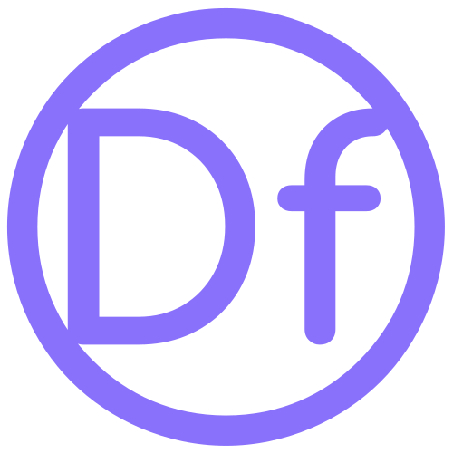

<table>
  <tr>
    <td width="100" align="center" valign="middle">
      
    </td>
    <td valign="middle">
      <h1>Hi, I'm Sayvai Tosu 👋</h1>
      <strong>Senior Software Engineer</strong>
       
      AI-Augmented Engineering
    </td>
  </tr>
</table>

---

Senior Software Engineer with **15+ years' experience** designing, architecting and delivering scalable, user-centric software products across media, fintech, healthcare and SaaS.

My engineering experience spans **React, TypeScript, Node.js and full-stack product delivery**, complemented by strong technical judgement, evidence-led problem-solving and a focus on performance optimisation and reliable software engineering.

I'm particularly interested in how **Agentic AI and AI-assisted engineering** can extend traditional development workflows beyond code generation — from automated investigation and root-cause analysis to intelligent code reviews and engineering quality.

🌐 **Portfolio:** [digiflow.dev](https://digiflow.dev)
💼 **LinkedIn:** [linkedin.com/in/sayvai](https://www.linkedin.com/in/sayvai/)

---

## Engineering Focus

- **Product & Frontend Engineering:** React, TypeScript, JavaScript, Next.js, reusable UI architecture and design systems.
- **Full-Stack Development:** Node.js, Express, NestJS, REST APIs and GraphQL integrations.
- **Agentic AI Engineering:** Claude Code, Claude Agent SDK, custom skills and AI-assisted engineering workflows.
- **Performance & Debugging:** Browser profiling, CPU optimisation, network analysis and evidence-led root-cause investigation.
- **Testing & Quality:** Playwright, Cypress, Jest, React Testing Library and CI/CD automation.

---

## Technical Skills

### AI & Agentic Engineering

  
  
  
  

### Frontend & Web Technologies

  
  
  
  
  
  
  
  
  
  
  
  

### Backend & APIs

  
  
  
  
  

### Testing & Engineering Quality

  
  
  
  
  

### Tooling, IDE & Platforms

  
  
  
  
  
  
  
  
  
  
  

---

## Certifications

---

## Connect

  
  

---

Technology badges powered by <a href="https://shields.io/">Shields.io</a> and brand icons from <a href="https://simpleicons.org/">Simple Icons</a>.
